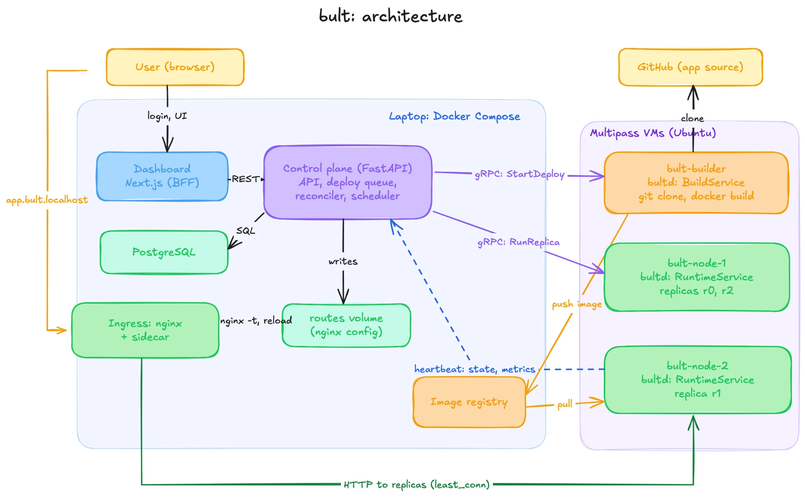

# bult

bult is a small platform as a service, like a mini Heroku. You give it a public Git repository and a preset, and it builds an image, runs the app as one or more replicas on several nodes, and puts it behind a load balancer at `http://<app>.bult.localhost`.

I built it as a course project to understand how a deployment platform works inside, so everything runs on one laptop: the control plane in Docker Compose and three Ubuntu virtual machines that play the role of servers.



## What it can do

- Deploy an app from Git with a preset (FastAPI, Express or a static site), redeploy with blue-green switching, roll back and cancel a deploy.
- Run several replicas of an app on different nodes and balance traffic between them with nginx (`least_conn` by default).
- Stop, start and scale an app without a new build, set environment variables (values are write-only), read logs and see CPU and memory charts.
- Route a path of one app to another app, for example `/api` of a frontend to a backend, so they share one origin.
- Repair itself: dead or hung replicas are replaced, crash loops are stopped with the exit code and last log lines, and replicas of a dead node are moved to other nodes.
- Keep deploys alive across a restart of the control plane, because PostgreSQL works as the deploy queue.

## Repository

- `control-plane/`: REST API, deploy worker, reconciler and scheduler (Python, FastAPI, PostgreSQL)
- `agent/`: node agent `bultd` that builds images and runs replicas with Docker (Go, gRPC)
- `proto/`: gRPC contract between the control plane and the agent
- `web/`: dashboard (Next.js)
- `deploy/`: nginx ingress, systemd unit for the agent, cloud-init for the VMs
- `examples/`: demo apps for every preset
- `bench/`: load balancing benchmark
- `docs/architecture/`: a short design document for every part

## Requirements

macOS or Linux with Docker, Multipass, Python 3.10+ and `uv`. Go is optional, because without it the agent is built inside a Docker container. `hey` is needed only for the benchmark.

## Run it

Create the virtual machines once. The commands below assume the Multipass bridge address `192.168.252.1`, which is used for the registry and the API.

```sh
for vm in bult-builder bult-node-1 bult-node-2; do
  multipass launch 24.04 --name $vm --cpus 2 --memory 2G --disk 15G --cloud-init deploy/multipass/cloud-init.yaml
  multipass exec $vm -- sh -c "curl -fsSL https://get.docker.com | sudo sh"
done
```

Install the agent on the nodes and start everything:

```sh
python3 scripts/dev.py agent-setup
python3 scripts/dev.py agent-deploy
python3 scripts/dev.py demo-up
```

Open the dashboard at http://localhost:3000, register, create an app (for example preset `fastapi` with subdirectory `examples/fastapi-hello` of this repository) and press Deploy. When it is running, the app opens at `http://<name>.bult.localhost`.

Other useful commands:

```sh
python3 scripts/dev.py smoke       # runs the whole app lifecycle as a check
python3 scripts/dev.py cp-check    # control plane tests, type check and import rules
python3 scripts/dev.py agent-test  # agent tests
python3 scripts/dev.py demo-down   # stops everything (add --wipe to forget all apps)
```

On macOS, run commands that talk to the VMs from a terminal that has the Local Network permission, otherwise `multipass exec` fails with "No route to host".

## Limitations

- It runs on one laptop, so it shows how the system works, not how much load it can handle.
- Only public Git repositories are supported.
- gRPC between the control plane and the agents and the image registry are not encrypted.
- There are no database add-ons yet, so an app that keeps state in memory gives different answers from different replicas.

The design of every part, with the options I compared, is in `docs/architecture/`, and the benchmark is in `bench/`.
